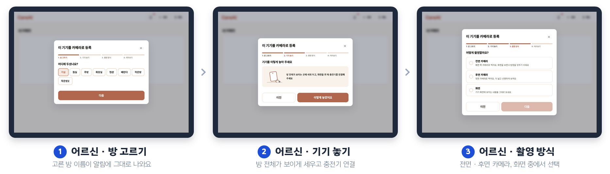
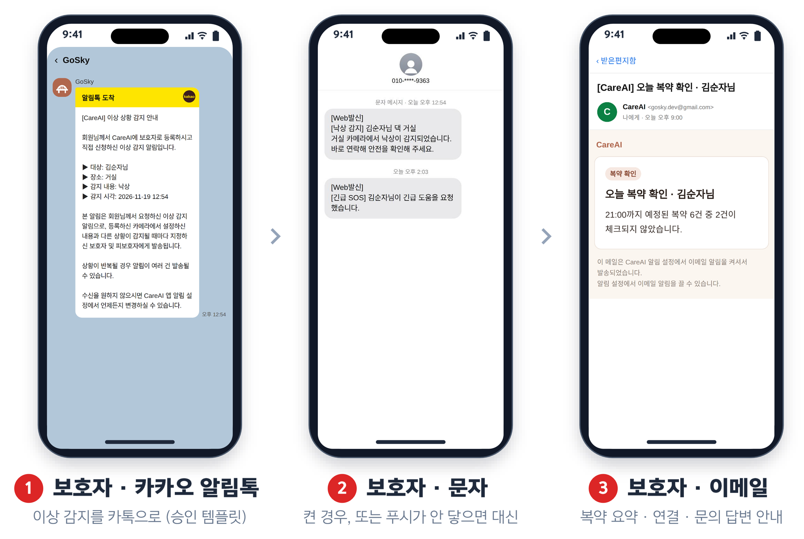
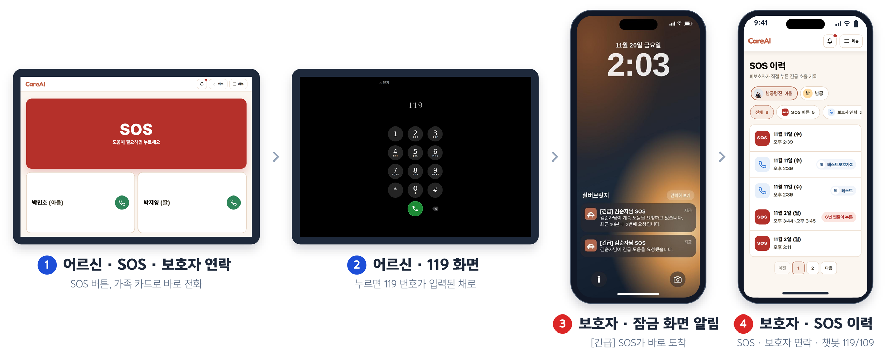
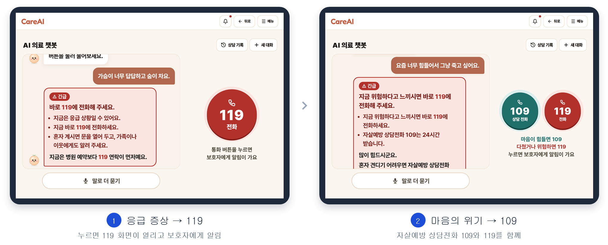
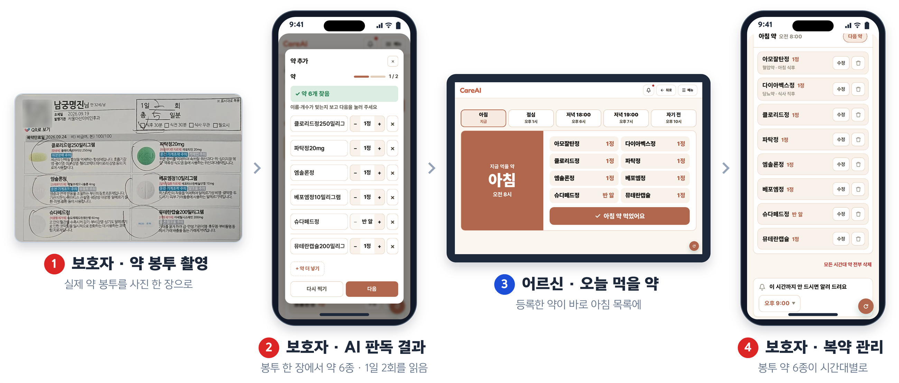
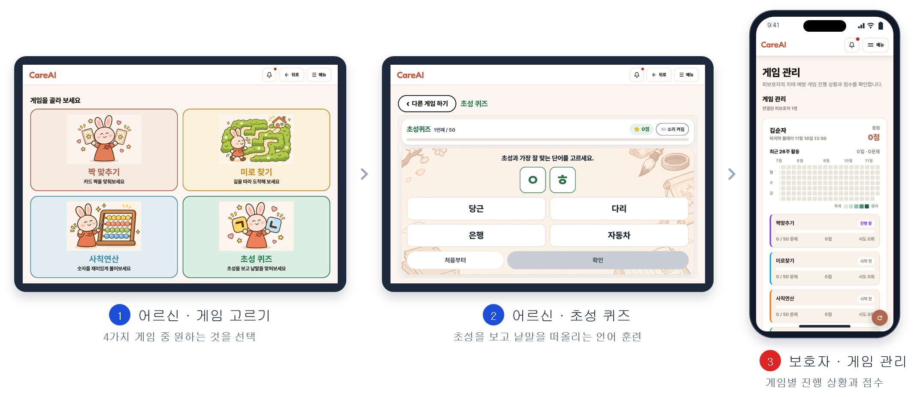
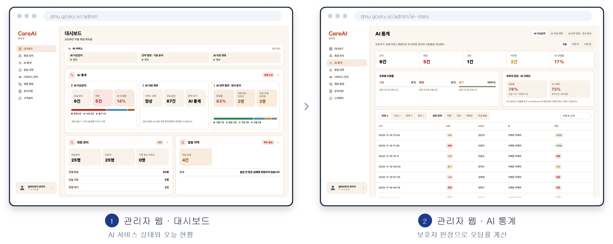
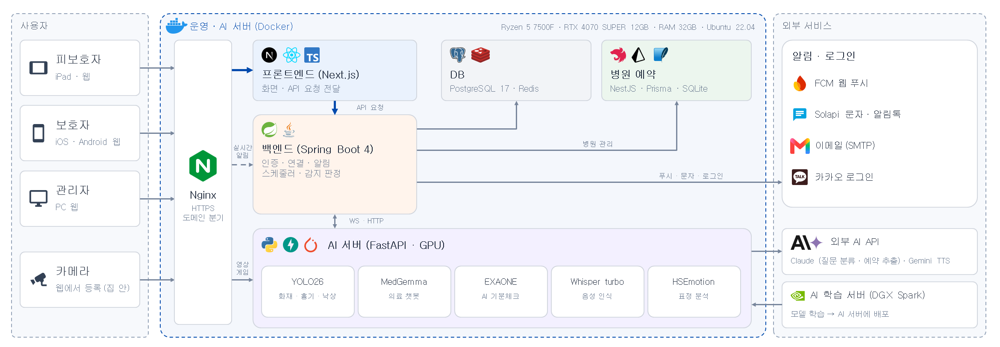

# 🌉 SilverBridge · CareAI

**혼자 사는 어르신의 안전 · 건강 · 마음을 AI가 곁에서 돌봅니다**

AI 기반 독거노인 통합 케어 플랫폼 - 동양미래대학교 캡스톤디자인

---

## 목차

1. [프로젝트 소개](#1-프로젝트-소개)
2. [핵심 기능](#2-핵심-기능)
3. [실제 화면](#3-실제-화면)
4. [AI 성과](#4-ai-성과)
5. [시스템 구성](#5-시스템-구성)
6. [기술 스택](#6-기술-스택)
7. [한계와 개선 방향](#7-한계와-개선-방향)
8. [팀 구성](#8-팀-구성)
9. [시연 영상 · 발표 자료](#9-시연-영상--발표-자료)
10. [저장소](#10-저장소)

---

## 1. 프로젝트 소개

> **여러분은 부모님의 위험한 순간을 제때 알아차릴 수 있다고 확신하십니까?**

CareAI는 혼자 사는 어르신을 위한 **AI 통합 케어 플랫폼**입니다.
집 안 카메라 영상에서 AI가 화재 · 흉기 · 낙상을 찾아 가족에게 바로 알리고,
AI 의료 챗봇이 증상 상담부터 병원 예약까지 돕고, AI가 하루 다섯 번 먼저 안부를 물어 기분을 살핍니다.

### 왜 필요한가

| 수치 | 내용 |
| :---: | --- |
| **40%** | 2050년 시니어 인구 비중 - 대한민국 인구 10명 중 4명, 약 1,900만 명 |
| **52.6%** | 혼자 사는 어르신의 치매 유병률 - 2인 가구(33.7%)보다 1.6배 |
| **90.6%** | 고독사가 집 안에서 일어난 비율 - 2023년 3,661건, 매년 최고치 |

출처: 국가데이터처(KOSIS 국가통계포털) · 보건복지부 고독사 실태조사

---

## 2. 핵심 기능

| 영역 | 기능 | 내용 |
| :---: | --- | --- |
| 🛡️ **안전** | AI 이상 감지 | 카메라 영상에서 화재 · 흉기 · 낙상을 찾아 보호자에게 바로 알림 |
| | 긴급 SOS | 버튼 한 번으로 가족에게 알림, 119 화면 바로 열기 |
| 💊 **건강** | AI 의료 챗봇 | 증상 상담 → 진료과 안내 → 병원 예약까지 한 번에 |
| | 복약 관리 | 약 봉투 사진 한 장으로 등록, 먹을 시간에 알림 |
| 💛 **마음** | AI 기분체크 | AI가 먼저 안부를 묻고 대화 · 표정으로 기분 분석 |
| | 치매 예방 게임 | 짝 맞추기 · 미로 찾기 · 사칙연산 · 초성 퀴즈 4종 |
| 🛠️ **운영** | 관리자 | 회원 · 병원 · AI 상태 · 통계를 웹 화면 하나에서 관리 |

---

## 3. 실제 화면

> 어르신은 iPad(태블릿 웹), 보호자는 휴대폰 웹, 관리자는 PC 웹으로 사용합니다. 아래는 실제 서버에서 캡쳐한 화면입니다.

### 3.1 AI 이상 감지

**집에 있는 기기를 카메라로 등록하면, AI가 지켜보기 시작합니다.**

**AI가 위험으로 판정하면, 보호자 휴대폰에 바로 알림이 옵니다.**

- 카메라 영상을 초당 15장씩 분석해 화재 · 흉기 · 낙상을 찾습니다. 낙상은 6초 이상 쓰러져 있을 때 위험으로 봅니다.
- 위험하면 5초 영상을 저장하고, 10분 안의 같은 감지는 1건으로 묶어 알림이 쏟아지지 않게 합니다.
- 보호자가 "실제 상황 / 오탐"으로 답하면 그 판정이 AI 오탐률 통계로 쌓입니다.

### 3.2 알림 채널

**앱 푸시는 늘 보내고, 카카오 알림톡 · 문자 · 이메일은 보호자가 켠 대로 함께 보냅니다.**

### 3.3 긴급 SOS

**SOS 버튼도, 가족 전화도 누르는 즉시 보호자에게 알림이 가고 이력에 남습니다.**

- 실수로 눌러도 한 번 더 확인하고, 보낸 뒤에는 119 번호가 입력된 화면을 바로 엽니다(전화를 자동으로 걸지는 않습니다).
- 앱 푸시가 닿지 않으면 문자로 대신 보냅니다.

### 3.4 AI 의료 챗봇

**어르신은 버튼으로 답하며 진료과 안내를 받고, 보호자도 같은 챗봇으로 상담합니다.**

**위험한 말이 나오면 상담 대신 119 · 109 버튼을 바로 띄웁니다.**

**챗봇으로 예약하면, 보호자 화면에 '병원 가는 날'로 바로 보입니다.** (제휴 병원 46곳)

### 3.5 복약 관리

**먹을 시간에 알려 주고, 체크하지 않으면 보호자가 압니다.**

- 보호자가 약 봉투를 사진 한 장으로 찍으면 AI가 약 이름 · 복용 시간을 읽고, 허가 약 목록과 대조해 비슷한 글자를 바로잡습니다.

### 3.6 AI 기분체크

**AI가 먼저 안부를 묻고, 보호자는 기분을 날짜별로 봅니다.**

- 하루 다섯 번(9 · 12 · 15 · 18 · 21시) AI가 먼저 말을 겁니다.
- 어르신의 말을 받아쓰고(Whisper), 말 내용으로 기분을 판단하며(EXAONE 기분 모델) 표정 분석(HSEmotion)은 보조로 씁니다.
- 위험 신호가 보이면 보호자에게 알립니다.

### 3.7 치매 예방 게임

**어르신이 직접 고르고 바로 즐기는 인지 훈련 게임 4종, 기록은 보호자 화면에 쌓입니다.**

### 3.8 관리자

**회원 · AI 상태 · 통계를 웹 화면 하나에서 봅니다.** 변경 조작은 모두 감사 로그로 남고, 영상 · 대화 내용은 관리자도 볼 수 없습니다.

---

## 4. AI 성과

### 4.1 AI 이상 감지

여러 차례 다시 학습하며, 실제 영상에서 더 잘 찾는 모델만 골라 배포했습니다.

| 위험 | 모델 | 탐지율 | 오탐률 | 학습 데이터 |
| --- | :---: | :---: | :---: | --- |
| 🔥 화재 | YOLO26 nano | **83.3%** | 10% | 사진 6.5만 장 · 영상 2,500개 |
| 🔪 흉기 | YOLO26 medium | **89.8%** | 10% | 사진 6만 장 · 영상 74개 |
| 🧍 낙상 | YOLO26 nano | **75.7%** | 8.5% | 사진 14만 장 · 영상 4.8만 개 |

낙상은 오탐(앉기 · 눕기를 낙상으로 착각)을 38.7%에서 8.5%로 줄이는 쪽을 택해, 탐지율이 92.6%에서 75.7%로 낮아졌습니다.
데이터 출처: AI Hub · ETRI · Science Data Bank · Roboflow · Hugging Face · Harvard Dataverse · Toyota Smarthome · Kaggle · 계명대학교 등

### 4.2 AI 의료 챗봇

AI에게 주는 **지시문(프롬프트)을 두 갈래로 고쳤습니다.**
질문을 나누는 AI(Claude)는 응급 · 자해 판단을, 답을 쓰는 의료 AI(MedGemma)는 일반 증상 답을 맡습니다.

| 확인한 것 | 처음 | 지금 |
| --- | :---: | :---: |
| 응급 질문에 119를 안내하나요? | 63% (19/30) | **100%** (37/37) |
| 숨을 안 쉬는 상황에 가슴압박 · AED를 안내하나요? | 0% (0/24) | **100%** (30/30) |
| 병원에 갈 기준을 알려 주나요? | 38% (18/48) | **88%** (42/48) |
| 필요 없는데 119를 말하나요? (낮을수록 좋음) | 46% (21/46) | **4%** (3/77) |

시험지는 질병관리청 · 2025 응급처치 가이드라인 · 국가건강정보포털을 근거로 만든 어르신 건강 질문 597문항입니다. 응급 · 자해 안내는 응급 낱말 규칙과 함께 동작합니다.

### 4.3 AI 기분체크

| 확인한 것 | 처음 | 지금 |
| --- | :---: | :---: |
| 어르신 말을 틀리게 받아쓰나요? (글자 오류율, 낮을수록 좋음) | 14.8% | **2.4%** |
| 돌려 말한 자살 신호를 찾나요? (40문장) | 14% | **93%** |
| 대답만 듣고 기분을 맞히나요? (800문장) | 75.4% | **83.8%** |
| 안전한 날에 알림이 잘못 울리나요? (27명 × 7일, 낮을수록 좋음) | 33% | **4%** |

시험 자료: AI Hub 어르신 대화 음성 · AI Hub 감성대화 · 네이버 CareCall 안부 전화 등 공개 자료

---

## 5. 시스템 구성

어르신 · 보호자 · 관리자 화면이 하나의 서버로 이어집니다.

| 서버 | 역할 | 사양 |
| --- | --- | --- |
| 운영 · AI 서버 | 서비스 운영 · AI 추론 (Docker) | Ryzen 5 7500F · RTX 4070 SUPER 12GB · RAM 32GB · Ubuntu 22.04 |
| 개발 서버 | 개발 · 검증 | HPE ProLiant DL360 Gen10 · Xeon Silver 4112 · RAM 62GB · Rocky Linux 9.7 |
| AI 학습 서버 | 모델 학습 → 운영 서버에 배포 | NVIDIA DGX Spark · GB10 · 128GB 통합 메모리 · Ubuntu 24.04 |

---

## 6. 기술 스택

| 분류 | 기술 |
| --- | --- |
| **Frontend** | Next.js · React · TypeScript · Node.js |
| **Backend** | Java 21 · Spring Boot 4 · JPA · Flyway · WebSocket · NestJS · Prisma (병원 예약) |
| **AI** | Python · FastAPI · PyTorch · YOLO26 · OpenCV · MedGemma · EXAONE · Whisper · HSEmotion · Claude API · Gemini TTS |
| **Database** | PostgreSQL 17 · Redis · SQLite |
| **알림 · 로그인** | Firebase FCM 웹 푸시 · Solapi 문자 · 카카오 알림톡 · SMTP 이메일 · 카카오 로그인 |
| **DevOps** | Ubuntu · Docker · Nginx · GitHub Actions |

---

## 7. 한계와 개선 방향

| 한계 | 지금 상황 | 이유 |
| --- | --- | --- |
| **서버 하드웨어** | GPU 1장(12GB)을 AI 3개가 나눠 씀 - 카메라는 전체 3대까지, 의료 AI 답은 약 11초 | 장비를 늘릴 수 없어 서버 한 대로 운영 |
| **병원 시스템 연동** | 병원 46곳 · 가상 데이터, 예약은 우리 서비스에만 저장 | 병원 전산(EMR) 연동은 계약 · 허가가 필요 |
| **전문가 검증** | 의사 검토 없이 팀원 각자 100문항 검수, 정답 기준은 공식 자료로 | 의료진 검토는 병원 · 기관 협력이 필요 |

---

## 8. 팀 구성

동양미래대학교 · 지도교수 **이희진** 교수님

| 이름 | 역할 |
| --- | --- |
| 이하늘 | **팀장** · PM · 인프라 |
| 남궁명진 | **백엔드** |
| 이재희 | **AI 엔지니어** |
| 이윤아 | **프론트엔드** |

---

## 9. 시연 영상 · 발표 자료

### 시연 영상

이미지를 누르면 YouTube 시연 영상으로 이동합니다.

| AI 이상 감지 테스트 (실제 가정 환경 촬영) | |
| --- | --- |
| [▶ 흉기 감지 테스트](videos/흉기감지_테스트.mp4) | [▶ 낙상 감지 테스트](videos/낙상감지_테스트.mp4) |

### 발표 자료

| 구분 | 파일 |
| --- | --- |
| 프로젝트 브로셔 | [PDF](docs/실버브릿지_브로셔.pdf) |
| 1학기 중간발표 (프로젝트 제안서) | [PPT](docs/실버브릿지_중간발표.pptx) |
| 1학기 최종발표 | [PPT](docs/실버브릿지_최종발표.pptx) |
| 2학기 프로젝트 계획서 | [PPT](docs/실버브릿지_2학기_프로젝트계획서.pptx) |
| 2학기 중간평가 | [PPT](https://download.gosky.kr/d/SilverBridgeSky/%EC%8B%A4%EB%B2%84%EB%B8%8C%EB%A6%BF%EC%A7%80_2%ED%95%99%EA%B8%B0_%EC%A4%91%EA%B0%84%ED%8F%89%EA%B0%80.pptx) |

---

## 10. 저장소

| 저장소 | 설명 |
| --- | --- |
| [SilverBridgeFe](https://github.com/Dongyang-Mirae-University-software/SilverBridgeFe) | 프론트엔드 (Next.js) |
| [SilverBridgeBe](https://github.com/Dongyang-Mirae-University-software/SilverBridgeBe) | 백엔드 (Spring Boot 4) |
| [SilverBridgeAiServer](https://github.com/Dongyang-Mirae-University-software/SilverBridgeAiServer) | AI 서버 (이상 감지 · 의료 챗봇 · AI 기분체크 · 게임) |
| [SilverBridgeReservation](https://github.com/Dongyang-Mirae-University-software/SilverBridgeReservation) | 병원 예약 서비스 (NestJS) |
| [AiSilverBridgeSky](https://github.com/Dongyang-Mirae-University-software/AiSilverBridgeSky) | YOLO 이상 감지 모델 학습 · 추론 |
| [ChatSilverBridge](https://github.com/Dongyang-Mirae-University-software/ChatSilverBridge) | MedGemma 의료 챗봇 서버 |
| [SilverBridgeQA](https://github.com/Dongyang-Mirae-University-software/SilverBridgeQA) | 실제 화면 E2E QA 자동화 (Playwright) |
| [SilverBridgeAi](https://github.com/Dongyang-Mirae-University-software/SilverBridgeAi) | AI 서버 (초기 버전) |
