# 🌉 SilverBridge의 CareAI

**AI 기반 독거노인 통합 케어 플랫폼** — 안전, 건강, 마음까지 한 번에 챙기는 돌봄 서비스

     

[](https://devdmu.gosky.kr) [](https://www.youtube.com/watch?v=y4lUm_REdXM) [](docs/실버브릿지_브로셔.pdf)

---

## 1. 프로젝트 소개

CareAI는 독거노인을 위한 **AI 기반 통합 케어 플랫폼**입니다. 실시간 영상 AI가 위험을 감지하고, AI 의료 챗봇이 상담부터 병원 예약까지 돕고, AI 말벗이 일상의 외로움을 덜어 줍니다.

> **여러분은 부모님의 위험한 순간을 제때 알아차릴 수 있다고 확신하십니까?**

### 왜 필요한가

| 수치 | 내용 |
| :---: | --- |
| **40%** | 2050년 시니어 인구 비중 — 대한민국 인구 10명 중 4명, 약 1,900만 명 |
| **52.6%** | 1인 가구 노인 치매 유병률 — 전체 가구 형태 중 가장 높음 (2인 가구 33.7%) |
| **90.6%** | 고독사, "집 안"에서 발생 — 매년 증가, 2023년 3,661건으로 신기록 |

출처: KOSIS 국가통계포털 · 보건복지부 고독사 실태조사

### 핵심 기능

**위급한 순간에는 신속하게, 일상에서는 세심하게, 가족에게는 안심을**

| 번호 | 핵심 기능 | 내용 |
|---|---|---|
| 01 | AI 이상 감지 알림 & 긴급 SOS | 화재·낙상 등 위험 상황을 감지하고 보호자에게 즉시 알립니다. |
| 02 | AI 의료 챗봇 & 병원 예약 | 의료 상담부터 병원 예약, 복약 알림까지 지원합니다. |
| 03 | AI 안부 말벗 & 정서 상태 분석 | AI 대화와 감정 분석으로 정서 케어 및 인지 건강을 지원합니다. |

| | |
|:---:|:---:|
| 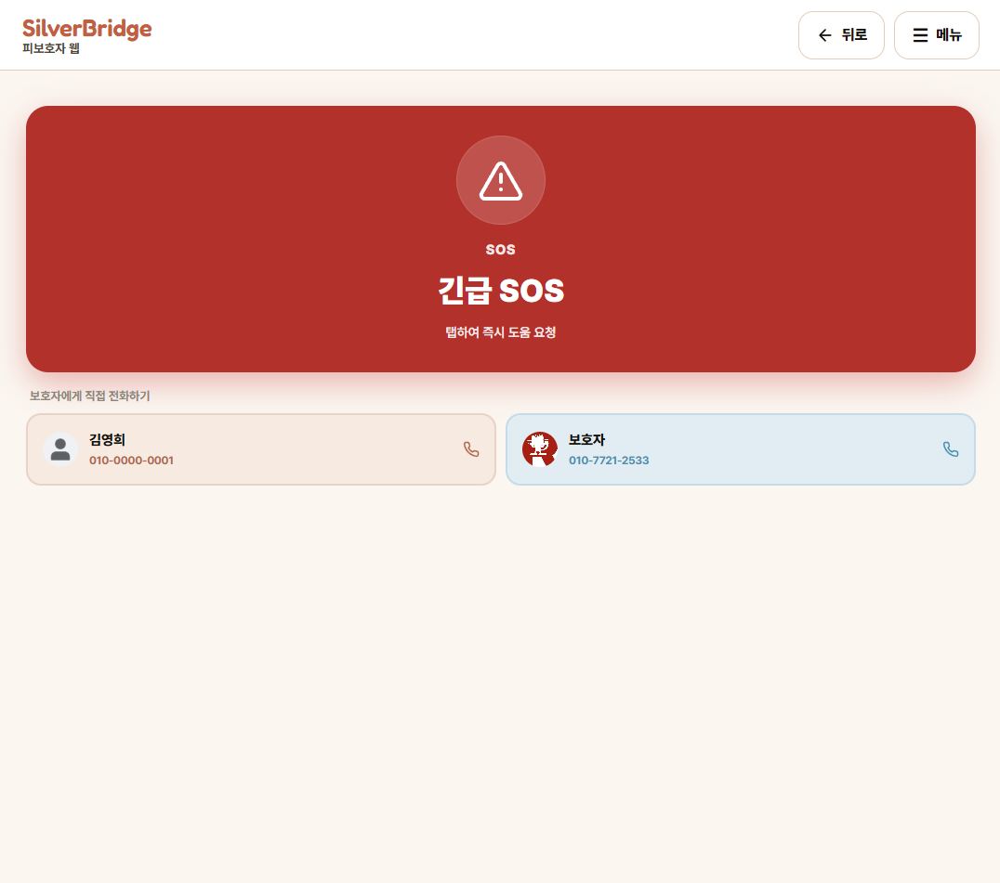<br/>**긴급 SOS** | 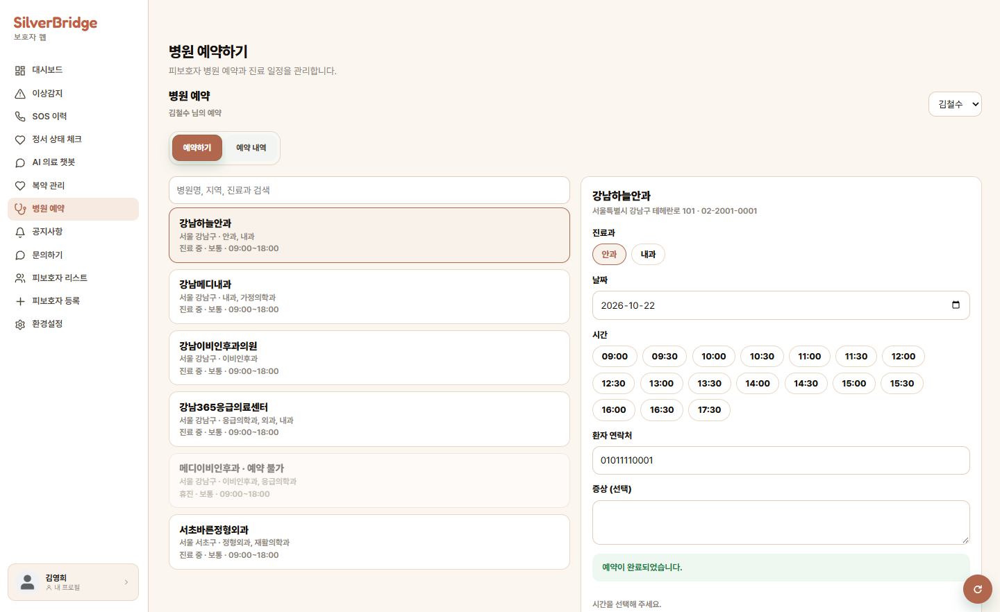<br/>**AI 챗봇 병원 예약** |

---

## 2. 세부 기능

| | 기능 | 내용 |
| :---: | --- | --- |
| 01 | **AI 정서 상태 분석** | 표정·텍스트로 이상 심리 조기 감지 |
| 02 | **AI 말벗** | 음성 대화로 외로움 해소·정서 케어 |
| 03 | **치매 예방** | 맞춤형 인지 훈련 게임 제공 |
| 04 | **AI 실시간 이상 감지** | 화재·흉기·낙상 자동 감지 알림 |
| 05 | **AI 의료 챗봇** | 의료 궁금증 24시간 즉시 답변 |
| 06 | **병원 예약** | 병원 검색·간편 예약·복약 알림 |

---

### 2.1 AI 이상 감지 · 알림 · SOS

**위험은 AI가 먼저 보고, 가족은 바로 압니다.**

- 🔔 **이상감지 알림** — 화재·낙상·흉기를 24시간 실시간으로 감지해 보호자 전원과 어르신에게 동시에 알립니다.
- 🆘 **위급상황 SOS** — 버튼 하나로 위치와 함께 앱 푸시를 보내고, 안 닿으면 문자, 이어서 119 연결을 안내합니다.

> AI가 위험을 알아맞힌 비율: 화재 **83.3%** · 낙상 **92.6%** · 흉기 **89.8%**

| | |
|:---:|:---:|
| <br/>**피보호자 · SOS 호출** | 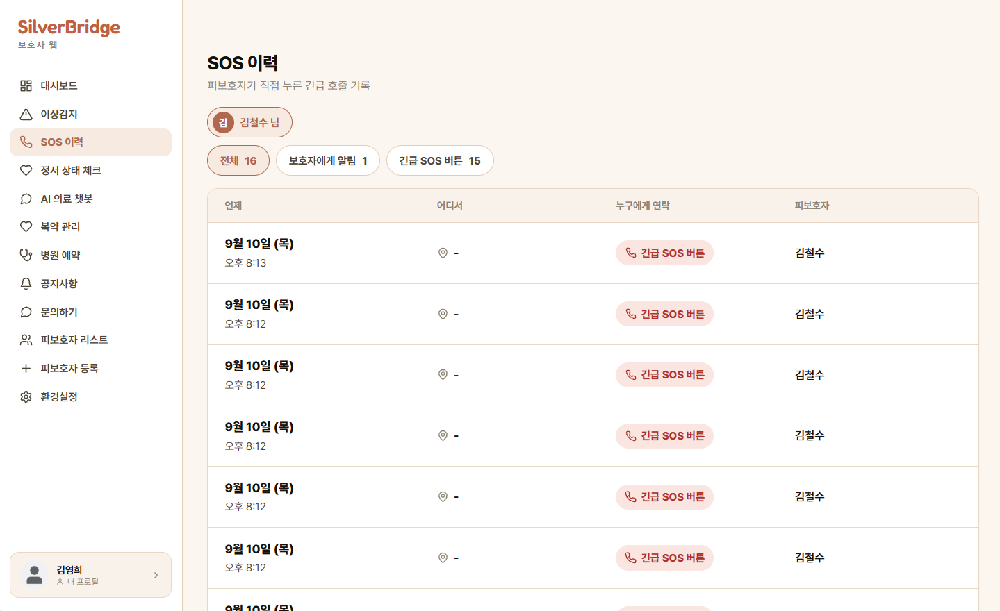<br/>**보호자 · SOS 수신** |
| 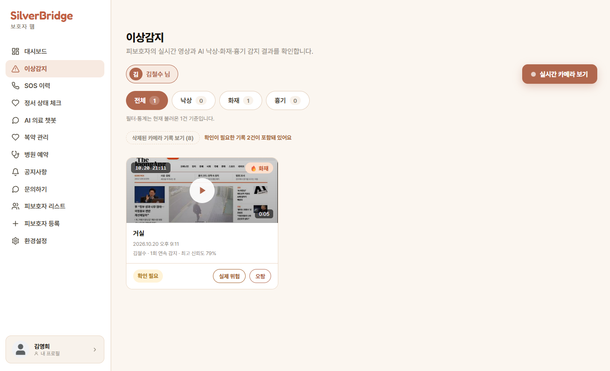<br/>**보호자 · 이상 감지 목록** | 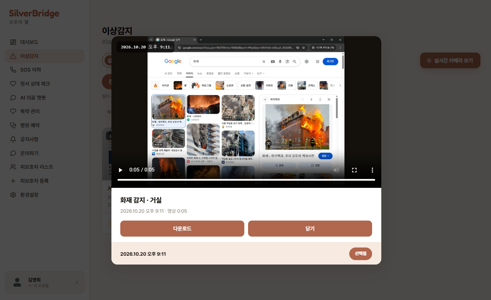<br/>**보호자 · 이상 감지 영상 확인** |

---

### 2.2 AI 의료 챗봇 · 병원 예약

**아플 때, 묻는 순간 답이 옵니다.** 상황에 맞는 AI가 건강 관리를 지원합니다.

| 모드 | 모델 | 역할 |
|---|---|---|
| 🚨 응급 증상 | MedGemma | 증상을 분석하고 적절한 대응을 안내 |
| 🗓️ 병원 예약 | GPT | 병원 검색 및 예약 대화 지원 |
| 💬 일반 문의 | GPT | 의료 관련 궁금증에 답변 |

```text
증상 말하기 → AI가 정리 → 병원 찾기 → 바로 예약
```

예약은 가족이 대신 해도 됩니다. AI 상담은 의료진의 진단을 대신하지 않습니다.

| | |
|:---:|:---:|
| 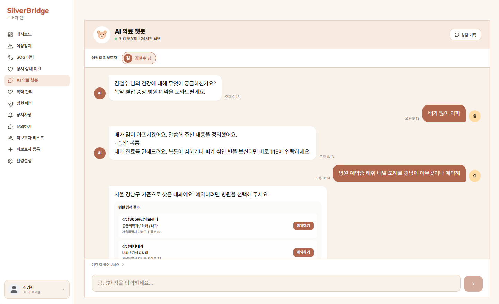<br/>**AI 의료 챗봇** | <br/>**병원 검색 · 예약** |
| <br/>**예약 현황** | |

---

### 2.3 복약 알림 · 치매 예방

**약 한 알, 게임 한 판. 매일이 쌓여 건강이 됩니다.**

- 복약 알림 · 진료 일정 자동 관리
- 치매 예방 두뇌 게임 — 카드 짝 맞추기 · 빈칸 채우기 · 더하기 · 빼기
- 어르신은 체크만, 복약과 게임 기록은 보호자 화면에 자동으로 쌓입니다.

| | |
|:---:|:---:|
| 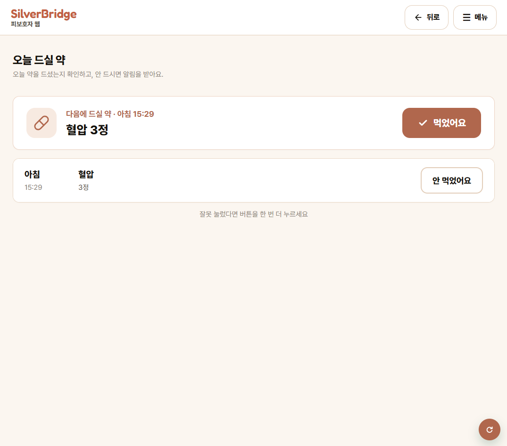<br/>**피보호자 · 복약** | 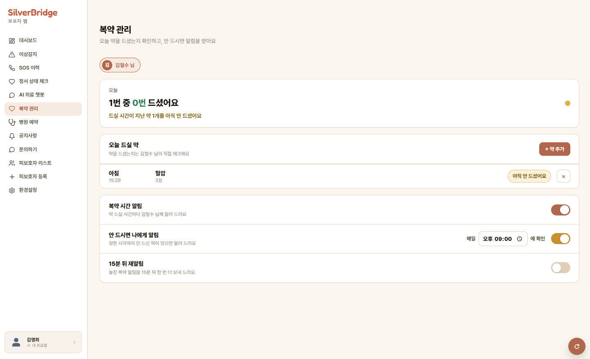<br/>**보호자 · 복약 관리** |
| 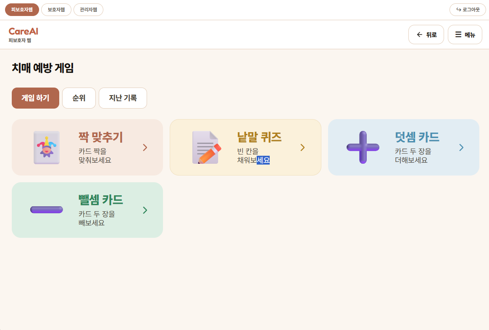<br/>**피보호자 · 치매 예방 게임** | |

---

### 2.4 AI 말벗 · 정서 분석 🔄 개발 중

**하루 다섯 번, 먼저 안부를 묻습니다.** 기다리지 않고 AI 말벗이 먼저 말을 건넵니다.

| 시간 | 안부 |
| :---: | --- |
| 9시 | 아침 식사는 하셨어요? |
| 12시 | 점심은 맛있게 드셨어요? |
| 15시 | 오늘 기분이 어떠세요? |
| 18시 | 요즘 즐거운 일이 있나요? |
| 21시 | 오늘 하루는 어떠셨어요? |

**대답 한마디로 오늘의 마음을 읽습니다.** 말투와 표정에서 오늘의 마음(평온·기쁨 등)을 분석하고, 평소와 다른 변화는 보호자에게 바로 알려 드립니다.

| | |
|:---:|:---:|
| 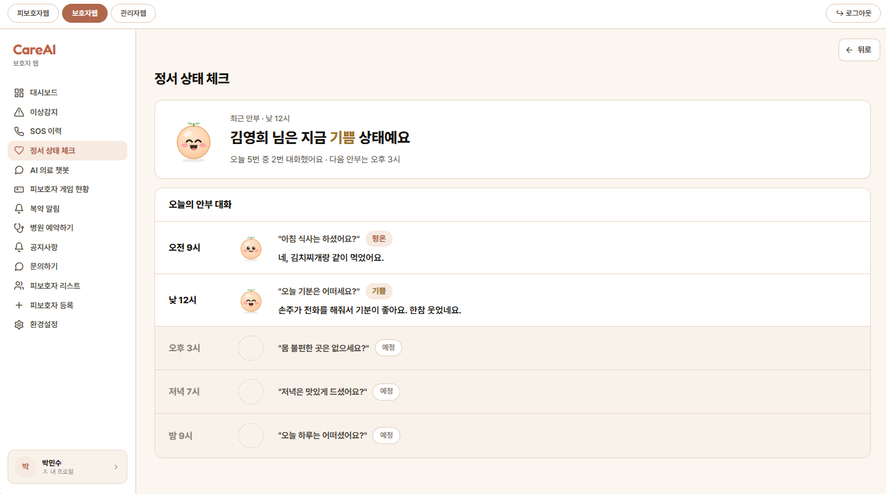<br/>**보호자 · 정서 상태 체크** | |

---

### 2.5 로그인 · 인증

**시니어도 보호자도 막힘없이 시작**

- **이메일 · 카카오 소셜 로그인** — 간편 로그인으로 진입 장벽 최소화
- **사용자 · 보호자 역할 분리** — 역할별 권한과 화면을 분기 제공
- **로그인 유지 · 계정 찾기** — JWT 기반 세션 유지 및 복구 지원

| | |
|:---:|:---:|
| 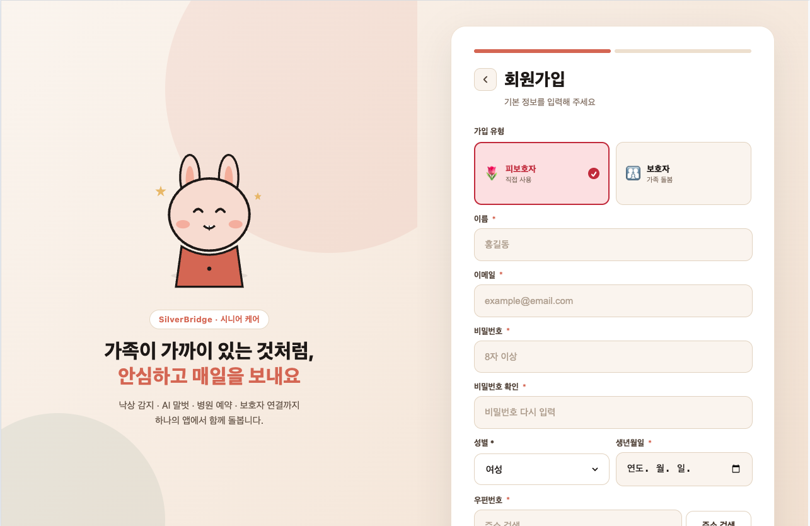<br/>**회원가입** | 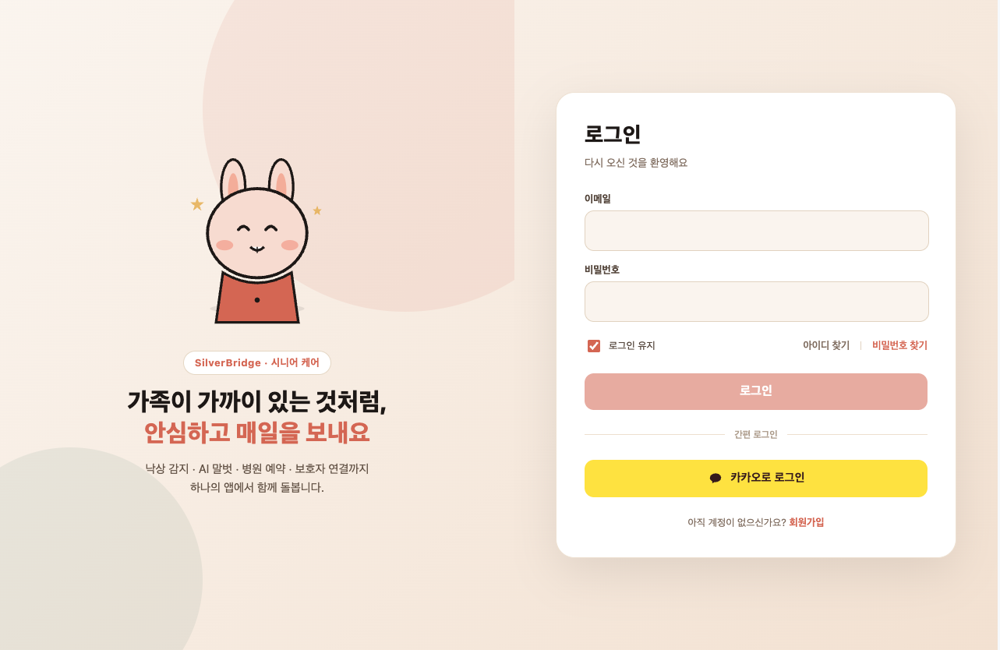<br/>**로그인** |

---

### 2.6 보호자 알림 및 외부 서비스 연동

**하나의 알림을 여러 채널로 보호자에게 동시에 전달**

| 채널 | 내용 |
| --- | --- |
| 웹 푸시 (앱 푸시) | 항상 발송 — 보호자 연결 요청을 실시간 알림 |
| 문자 (SMS) | 선택 — 인증번호 발송, 알림에도 사용 |
| 이메일 | 발송 연동 완료 |
| 카카오 알림톡 | 선택 |

알림 설정에서 사용자가 유형별 알림 방법을 직접 선택할 수 있습니다.

| | |
|:---:|:---:|
| 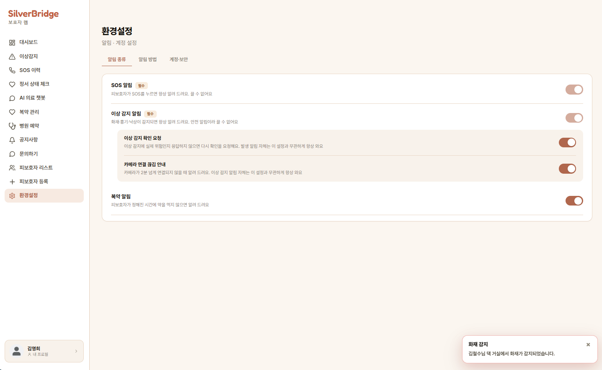<br/>**보호자 · 알림 환경설정** | 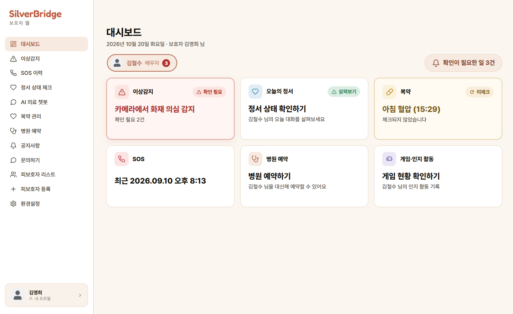<br/>**보호자 · 대시보드** |

---

### 2.7 보호자 · 피보호자 화면

| | |
|:---:|:---:|
| 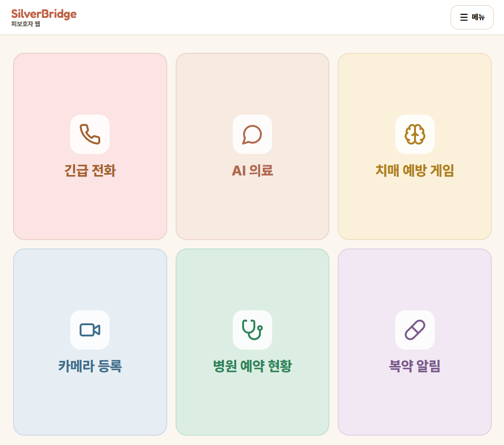<br/>**피보호자 · 메인 화면** | <br/>**피보호자 · 카메라 송출** |
| <br/>**피보호자 · 카메라 송출 중** | 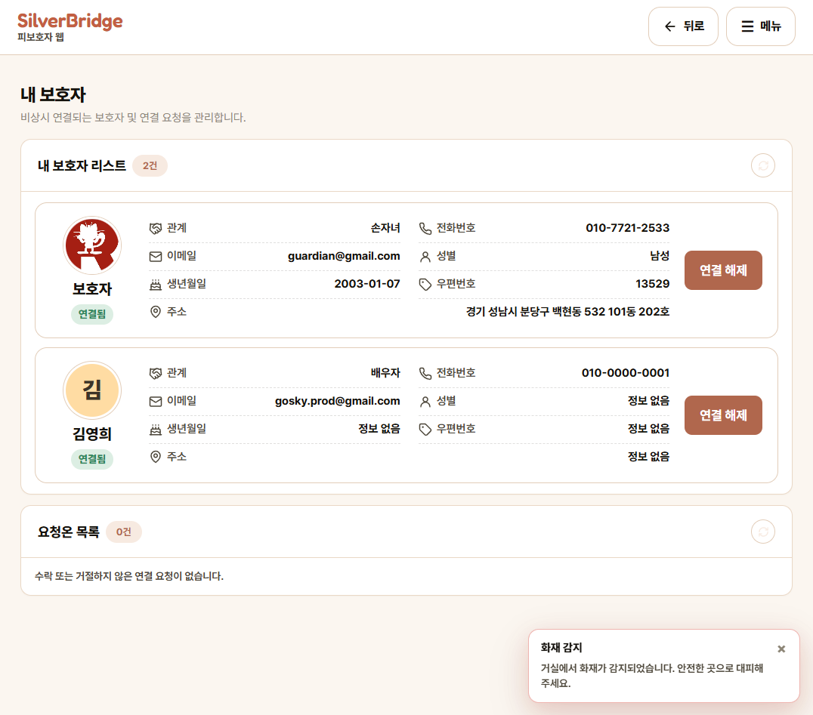<br/>**피보호자 · 내 보호자** |
| 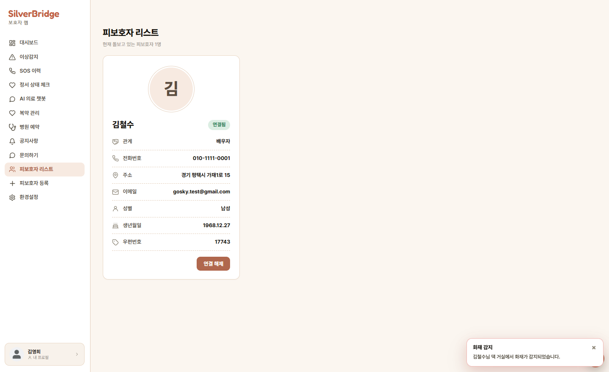<br/>**보호자 · 피보호자 연결** | 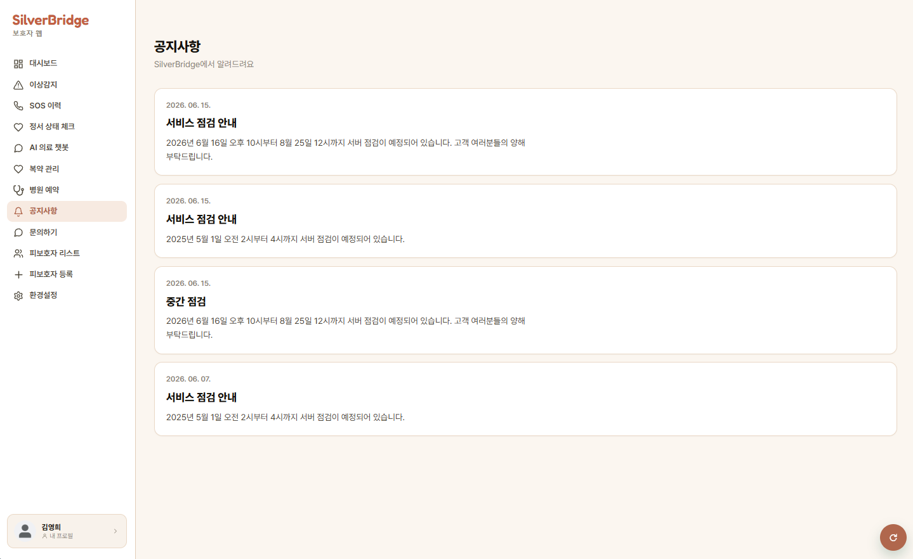<br/>**공지사항** |

---

## 3. 서비스 아키텍처 / 흐름


### 작품 사용 사례

**🚨 위험 상황 — 이상 감지 및 보호자 알림**

```text
카메라가 위험 상황 감지 → AI가 낙상·화재·흉기 분석 → 보호자 전원과 어르신에게 동시에 알림 → 보호자의 확인 답변으로 AI 정확도 개선
```

**🏥 의료 상담 · 예약 — 채팅 기반 증상 상담 및 병원 예약**

```text
증상·궁금증을 채팅으로 입력 → AI가 증상 정리·정보 제공 → 진료과 추천 및 병원 검색 → 필요 시 병원 예약 연결
```

---

## 4. 기술 스택

| 분류 | 기술 | 저장소 |
| --- | --- | --- |
| **Frontend** | Next.js, React, TypeScript | [](https://github.com/Dongyang-Mirae-University-software/SilverBridgeFe) |
| **Backend** | Java 21, Spring Boot, JPA/Hibernate | [](https://github.com/Dongyang-Mirae-University-software/SilverBridgeBe) |
| **AI** | Python, FastAPI, PyTorch, YOLO, OpenCV, MedGemma, GPT, EXAONE, HSEmotion | [](https://github.com/Dongyang-Mirae-University-software/SilverBridgeAiServer) |
| **Database** | PostgreSQL, Redis | |
| **DevOps** | Docker, Nginx, GitHub Actions | |

---

## 5. AI 구조 및 최적화

| 모델 | 용도 |
| --- | --- |
| **YOLO** | 화재 · 흉기 · 낙상 감지 |
| **MedGemma** | 응급 증상 의료 LLM |
| **GPT** | 병원 예약 · 일반 문의 챗봇 |
| **EXAONE** | AI 말벗 (개발 중) |
| **HSEmotion** | 표정·텍스트 정서 분석 (개발 중) |

- **흉기 감지** — 처음엔 인식률이 낮았지만 데이터셋을 재구성해 다시 학습하니 크게 좋아졌습니다. 학습 사진 1,594장 → 2,805장으로 확충해 4차 학습 모델을 최종 채택했고, 실시간 영상을 14.5 fps로 처리합니다.
- **화재 감지** — 불빛·노을 등을 불로 착각하는 오감지가 잦아, 오감지 사진을 걸러 데이터셋을 재구성해 재학습했습니다.

---

## 6. 개발 현황

**2학기 중간 발표 기준 — 정서 체크를 제외한 모든 기능 구현 완료**

| 기능 | 상태 |
| --- | :---: |
| 기획 / UI·UX 설계 / 인프라 | ✅ 완료 |
| 인증 시스템 | ✅ 완료 |
| AI 이상 감지 (화재·흉기·낙상) | ✅ 완료 |
| AI 의료 챗봇 | ✅ 완료 |
| 병원 예약 시스템 | ✅ 완료 |
| 사용자 인터페이스 | ✅ 완료 |
| 보호자 알림 및 외부 서비스 연동 | ✅ 완료 |
| 치매 예방 게임 | ✅ 완료 |
| 통합 테스트 / 배포 | ✅ 완료 |
| AI 감정 분석 · AI 말벗 (정서 체크) | 🔄 개발 중 |

### 제약사항 및 개선 방향

| 제약사항 | 개선 방향 |
| --- | --- |
| **AI 감지 정확도 한계** — 유사 행동(앉기, 눕기 등)과 구분이 어려워 오탐·미탐 발생 가능 | 낙상·일상행동 등 다양한 데이터 학습 및 데이터 증강을 통해 오탐·미탐 감소 |
| **카메라 시야 제약** — 카메라 위치 및 각도에 따라 일부 행동이 인식되지 않는 사각지대 발생 | 360도 카메라 및 다각도 촬영으로 사각지대 최소화 |
| **고령층 사용성 문제** — 복잡한 UI로 인해 고령층이 기능 사용에 어려움 발생 | SOS 버튼 및 보호자 호출 기능 중심의 단순하고 직관적인 UI 제공 |

---

## 7. 팀 구성

동양미래대학교 · 지도교수 **이희진** 교수님

| 이름 | 역할 |
| --- | --- |
| 이하늘 | **팀장** · PM · 인프라 |
| 남궁명진 | **백엔드** |
| 이재희 | **AI 엔지니어** |
| 이윤아 | **프론트엔드** |

---

## 8. 시연 영상 / 발표 자료

### 8.1 시연 영상

- **YouTube 시연 영상**

  [](https://www.youtube.com/watch?v=y4lUm_REdXM)

- **AI 이상감지 테스트 영상** (실제 가정 환경 CCTV 촬영)

  | 흉기 감지 | 낙상 감지 |
  | --- | --- |
  | [▶ 흉기감지_테스트.mp4](videos/흉기감지_테스트.mp4) | [▶ 낙상감지_테스트.mp4](videos/낙상감지_테스트.mp4) |

### 8.2 발표 자료 / 문서

| 구분 | 파일 |
| --- | --- |
| 프로젝트 브로셔 | [](docs/실버브릿지_브로셔.pdf) |
| 1학기 중간발표 (프로젝트 제안서) | [](docs/실버브릿지_중간발표.pptx) |
| 1학기 최종발표 | [](docs/실버브릿지_최종발표.pptx) |
| 2학기 프로젝트 계획서 | [](docs/실버브릿지_2학기_프로젝트계획서.pptx) |
| 2학기 중간평가 | [](docs/실버브릿지_2학기_중간평가.pptx) |

---

## 9. 저장소 목록

| 저장소 | 설명 |
| --- | --- |
| [SilverBridgeFe](https://github.com/Dongyang-Mirae-University-software/SilverBridgeFe) | Next.js 프론트엔드 |
| [SilverBridgeBe](https://github.com/Dongyang-Mirae-University-software/SilverBridgeBe) | Spring Boot 백엔드 |
| [SilverBridgeAi](https://github.com/Dongyang-Mirae-University-software/SilverBridgeAi) | AI 서버 (초기 버전) |
| [AiSilverBridgeSky](https://github.com/Dongyang-Mirae-University-software/AiSilverBridgeSky) | YOLO 이상감지 모델 학습·추론 서비스 |
| [ChatSilverBridge](https://github.com/Dongyang-Mirae-University-software/ChatSilverBridge) | MedGemma 의료 챗봇 서버 |
| [SilverBridgeReservation](https://github.com/Dongyang-Mirae-University-software/SilverBridgeReservation) | 병원 예약 서비스 (NestJS) |
| [SilverBridgeAiServer](https://github.com/Dongyang-Mirae-University-software/SilverBridgeAiServer) | AI 서버 (이상감지·의료 챗봇·인지훈련 게임) |
| [SilverBridgeQA](https://github.com/Dongyang-Mirae-University-software/SilverBridgeQA) | 실제 화면 E2E QA 자동화 (Playwright) |
