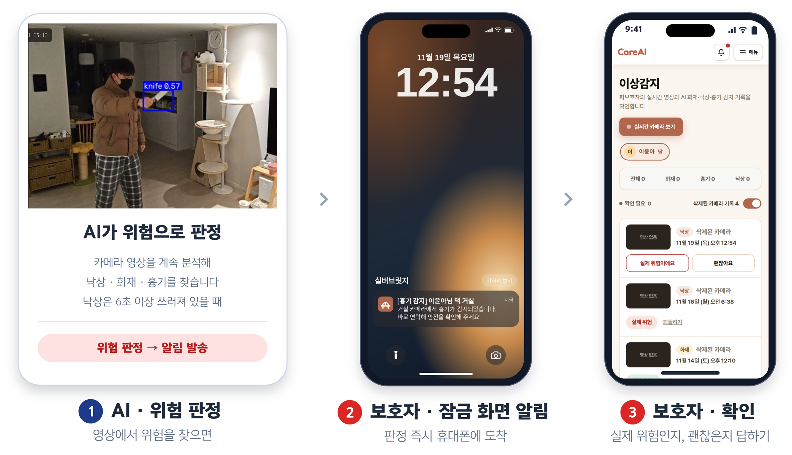
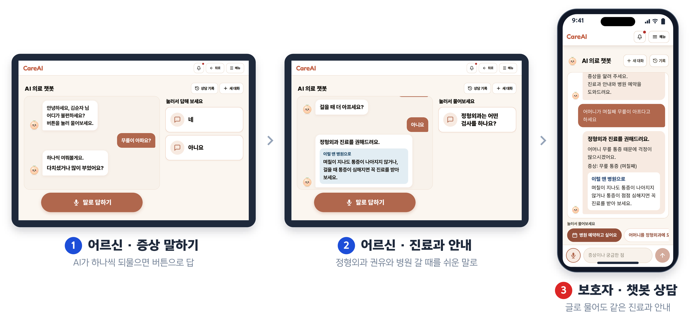
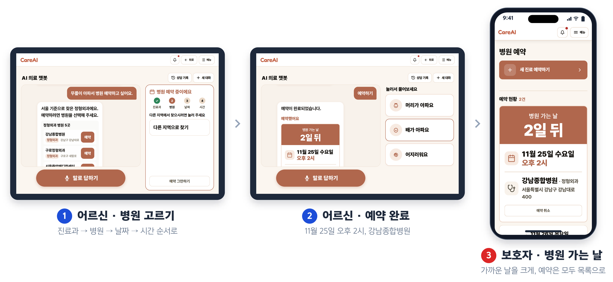
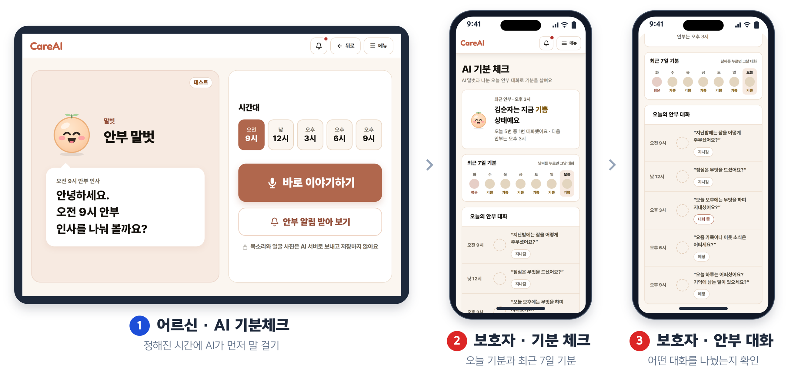
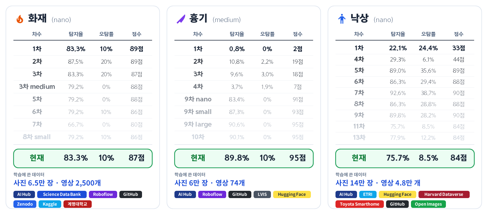
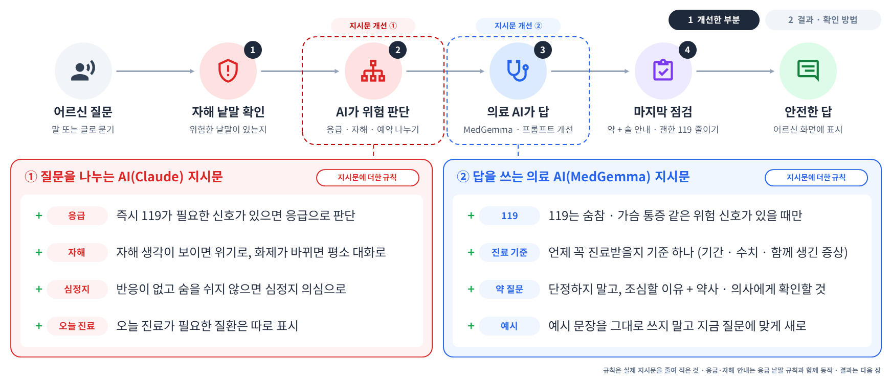
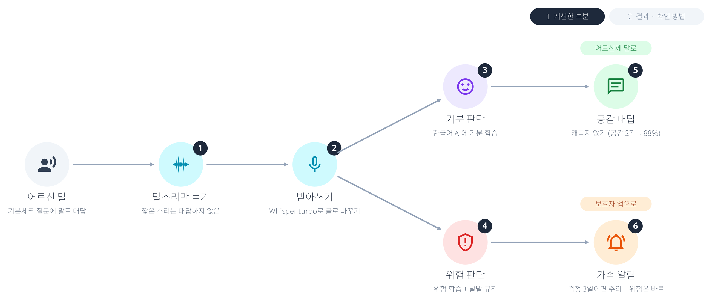
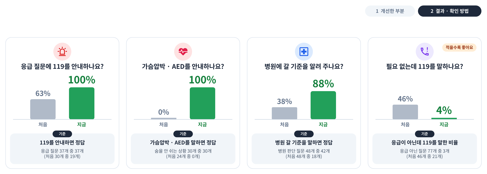
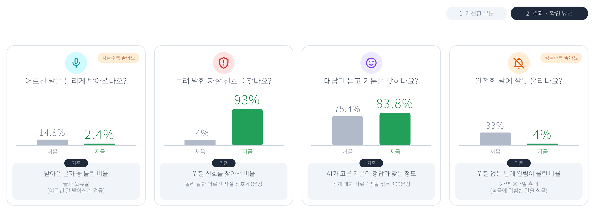
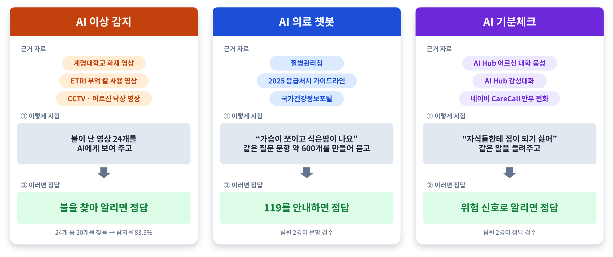

# 🌉 SilverBridge · CareAI

**혼자 사는 어르신의 안전 · 건강 · 마음을 AI가 곁에서 돌봅니다**

AI 기반 독거노인 통합 케어 플랫폼 - 동양미래대학교 캡스톤디자인

| 🔪 흉기 탐지율 | 🚑 응급 질문 119 안내 | 🎙️ 어르신 말 받아쓰기 오류 |
| :---: | :---: | :---: |
| **89.8%** | 63% → **100%** | 14.8% → **2.4%** |

모두 개선에 쓰지 않은 검증 자료로 잰 값입니다 - [성과](#-6-성과)

---

## 📑 목차

1. [🎬 데모](#-1-데모)
2. [❓ 문제](#-2-문제)
3. [💡 해결 - 안전 · 건강 · 마음](#-3-해결---안전--건강--마음)
4. [🏗️ 아키텍처](#️-4-아키텍처)
5. [🧗 기술적 도전](#-5-기술적-도전)
6. [📊 성과](#-6-성과)
7. [🚧 한계와 다음 단계](#-7-한계와-다음-단계)
8. [👥 팀 · 역할](#-8-팀--역할)
9. [🧰 기술 스택 · 저장소 · 발표 자료](#-9-기술-스택--저장소--발표-자료)

---

## 🎬 1. 데모

**🆕 CareAI v2 시연 영상 (4분 47초)** - 재생 버튼을 누르면 바로 볼 수 있습니다.

https://github.com/user-attachments/assets/8ff00f4b-a7fb-4111-b036-1b9f94667594

🎞️ 고화질(1080p) 영상은 [여기](videos/CareAI_v2_시연영상.mp4)에서 내려받을 수 있습니다.

📺 YouTube 시연 영상 · AI 이상 감지 테스트 영상

그림을 누르면 YouTube로 이동합니다.

**🎥 AI 이상 감지 테스트 영상** (실제 가정 환경 촬영)

- [🔪 흉기 감지 테스트](videos/흉기감지_테스트.mp4)
- [🧍 낙상 감지 테스트](videos/낙상감지_테스트.mp4)

---

## ❓ 2. 문제

> **여러분은 부모님의 위험한 순간을 제때 알아차릴 수 있다고 확신하십니까?**

| 수치 | 내용 |
| :---: | --- |
| 👵 **40%** | 2050년 시니어 인구 비중 - 대한민국 인구 10명 중 4명, 약 1,900만 명 |
| 🧠 **52.6%** | 혼자 사는 어르신의 치매 유병률 - 2인 가구(33.7%)보다 1.6배 |
| 🏠 **90.6%** | 고독사가 집 안에서 일어난 비율 - 2023년 3,661건, 매년 최고치 |

출처: 국가데이터처(KOSIS 국가통계포털) · 보건복지부 고독사 실태조사

혼자 사는 어르신에게 생기는 위험은 대부분 **집 안에서, 아무도 보지 않을 때** 일어납니다. 
가족은 멀리 있고, 어르신은 아파도 어디로 가야 할지, 기분이 가라앉아도 누구에게 말해야 할지 모릅니다.

---

## 💡 3. 해결 - 안전 · 건강 · 마음

CareAI는 **AI가 먼저 알아차리고, 가족에게 바로 알리는** 통합 케어 플랫폼입니다. 
어르신은 iPad(태블릿 웹), 보호자는 휴대폰 웹, 관리자는 PC 웹으로 사용합니다.

| 영역 | 기능 | 하는 일 |
| :---: | --- | --- |
| 🛡️ **안전** | 🚨 AI 이상 감지 | 집 안 카메라 영상에서 화재 · 흉기 · 낙상을 찾아 보호자에게 바로 알림 |
| | 🆘 긴급 SOS | 버튼 한 번으로 가족에게 알림, 119 화면 바로 열기 |
| 💊 **건강** | 🩺 AI 의료 챗봇 | 증상 상담 → 진료과 안내 → 병원 예약까지 한 번에 |
| | 💊 복약 관리 | 약 봉투 사진 한 장으로 등록, 먹을 시간에 알림 |
| 💛 **마음** | 😊 AI 기분체크 | AI가 하루 다섯 번 먼저 안부를 묻고 대화 · 표정으로 기분 분석 |
| | 🧩 치매 예방 게임 | 짝 맞추기 · 미로 찾기 · 사칙연산 · 초성 퀴즈 4종 |
| 🛠️ **운영** | 🖥️ 관리자 | 회원 · 병원 · AI 상태 · 통계를 웹 화면 하나에서 관리 |

> 아래 화면은 모두 실제 서버에서 캡처했습니다. 제목을 누르면 펼쳐집니다.

🚨 <b>AI 이상 감지</b> - 기기를 카메라로 등록하면 AI가 지켜보고, 위험하면 보호자에게 바로 알립니다

- 카메라 영상을 초당 15장씩 분석해 화재 · 흉기 · 낙상을 찾습니다.
- 보호자가 "실제 상황 / 오탐"으로 답하면 그 판정이 AI 오탐률 통계로 쌓입니다.

🔔 <b>알림 채널</b> - 앱 푸시는 늘 보내고, 알림톡 · 문자 · 이메일은 보호자가 켠 대로 함께 보냅니다

🆘 <b>긴급 SOS</b> - 누르는 즉시 보호자에게 알림이 가고 이력에 남습니다

- 실수로 눌러도 한 번 더 확인하고, 보낸 뒤에는 119 번호가 입력된 화면을 바로 엽니다(전화를 자동으로 걸지는 않습니다).
- 앱 푸시가 닿지 않으면 문자로 대신 보냅니다.

🩺 <b>AI 의료 챗봇</b> - 버튼으로 답하며 진료과 안내, 위험하면 119 · 109, 예약은 보호자 화면에

챗봇으로 예약하면 보호자 화면에 '병원 가는 날'로 바로 보입니다. (등록 병원 46곳 · 가상 데이터)

💊 <b>복약 관리</b> - 약 봉투 사진 한 장으로 등록, 체크하지 않으면 보호자가 압니다

- AI가 약 이름 · 복용 시간을 읽고, 허가 약 목록과 대조해 비슷한 글자를 바로잡습니다.

😊 <b>AI 기분체크</b> - AI가 먼저 안부를 묻고, 보호자는 기분을 날짜별로 봅니다

- 하루 다섯 번(9 · 12 · 15 · 18 · 21시) AI가 먼저 말을 겁니다.
- 어르신의 말을 받아쓰고(Whisper), 말 내용으로 기분을 판단합니다(EXAONE 기분 모델).
- 대답하는 동안 2초마다 얼굴 사진도 함께 보내, 표정 분석(HSEmotion)을 보조로 씁니다.
- 위험 신호가 보이면 보호자에게 알립니다.

🧩 <b>치매 예방 게임</b> - 인지 훈련 게임 4종, 기록은 보호자 화면에 쌓입니다

🖥️ <b>관리자</b> - 회원 · AI 상태 · 통계를 한 화면에서, 변경 조작은 감사 로그로

영상 · 대화 내용은 관리자도 볼 수 없습니다.

---

## 🏗️ 4. 아키텍처

어르신 · 보호자 · 관리자 화면이 하나의 서버로 이어지고, AI 모델은 학습 서버에서 만들어 운영 서버로 배포합니다.

| 서버 | 역할 | 사양 |
| --- | --- | --- |
| 🚀 운영 · AI 서버 | 서비스 운영 · AI 추론 (Docker) | Ryzen 5 7500F · RTX 4070 SUPER 12GB · RAM 32GB · Ubuntu 22.04 |
| 🧪 개발 서버 | 개발 · 검증 | HPE ProLiant DL360 Gen10 · Xeon Silver 4112 · RAM 62GB · Rocky Linux 9.7 |
| 🧠 AI 학습 서버 | 모델 학습 → 운영 서버에 배포 | NVIDIA DGX Spark · GB10 · 128GB 통합 메모리 · Ubuntu 24.04 |

---

## 🧗 5. 기술적 도전

> 만들면서 부딪힌 문제를 **문제 → 원인 → 해결 → 결과** 순서로 정리했습니다.

### ① 위험 알림이 쏟아지지 않게

- 🔍 **문제** 불이나 칼은 영상 속에 계속 보이므로, 그대로 두면 같은 위험으로 알림이 끝없이 갑니다.
- 🛠️ **해결** 10분 안의 같은 감지는 1건으로 묶고, 위험할 때 5초 영상을 저장해 보호자가 직접 확인하게 했습니다.
- ✅ **결과** 보호자의 "실제 상황 / 오탐" 답이 모여 AI 오탐률 통계가 됩니다.

### ② 낙상 - 놓치지 않기와 잘못 울리지 않기 사이의 선택

- 🔍 **문제** 앉기 · 눕기를 낙상으로 착각하는 오탐이 38.7%였습니다. 어르신 집에서는 하루에도 여러 번 눕습니다.
- 🛠️ **해결** 6초 이상 쓰러져 있을 때만 위험으로 보고, 오탐을 줄이는 쪽으로 다시 학습했습니다(DGX Spark에서 N차 학습, 실제 영상에서 더 잘 찾는 모델만 선택).
- ✅ **결과** 오탐 **38.7% → 8.5%**. 대신 탐지율은 92.6% → 75.7%로 내려갔습니다 - 알고 택한 대가입니다.

### ③ 의료 챗봇이 응급 상황을 놓치지 않게

- 🔍 **문제** 처음 챗봇은 응급 질문의 63%만 119를 안내했고, 숨을 안 쉬는 상황에 가슴압박 · AED를 한 번도 안내하지 않았습니다. 반대로 필요 없는 질문의 46%에 119를 말했습니다.
- 🛠️ **해결** 역할을 두 갈래로 나눴습니다. Claude는 질문이 위험한지(응급 · 자해 · 심정지) 먼저 판단하고, MedGemma는 증상 질문에 실제 답을 씁니다. 응급 낱말 규칙도 함께 동작합니다.
- ✅ **결과** 119 안내 **63% → 100%**, 가슴압박 · AED **0% → 100%**, 필요 없는 119 **46% → 4%**

📝 지시문 규칙을 글로 보기

| ① Claude: 위험한 질문인지 먼저 가려냄 | ② MedGemma: 증상 질문에 답할 때 |
| --- | --- |
| ➕ **응급** - 바로 119가 필요하면 → 응급 | ➕ **119** - 숨참 · 가슴 통증처럼 위험할 때만 119 안내 |
| ➕ **자해** - 자해 생각이 보이면 → 위기, 화제가 바뀌면 → 평소 대화 | ➕ **병원 갈 때** - "3일 넘게 아프면 병원에" 처럼 갈 때를 알려 주기 |
| ➕ **심정지** - 반응이 없고 숨을 안 쉬면 → 심정지 의심 | ➕ **약 질문** - 단정하지 않기 + 약사 · 의사 확인 권하기 |
| ➕ **오늘 진료** - 오늘 병원에 가야 하면 → 따로 표시 | ➕ **어르신** - 어르신이 물으면 → 쉬운 말로 짧게 |

규칙은 실제 지시문을 줄여 적은 것입니다.

### ④ 어르신의 말, 돌려 말한 위험 신호까지

- 🔍 **문제** 어르신 말은 받아쓰기 오류가 14.8%였고, "자식들한테 짐이 되기 싫어"처럼 돌려 말한 자살 신호는 14%만 찾았습니다. 위험 없는 날에도 알림이 33% 울렸습니다.
- 🛠️ **해결** 말소리만 골라 받아쓰고, 기분과 위험을 따로 판단하게 나눴습니다. 표정 분석은 보조로만 씁니다.
- ✅ **결과** 받아쓰기 오류 **14.8% → 2.4%**, 돌려 말한 위험 신호 **14% → 93%**, 잘못 울린 알림 **33% → 4%**

### ⑤ 긴급 알림이 다른 일에 밀리지 않게 (백엔드)

- 🔍 **문제** SOS · 화재 알림이 연결 · 문의 같은 일반 알림과 한 줄에 서면, 일반 알림이 몰릴 때 긴급 알림이 늦어집니다. 배포로 서버가 교체되는 순간 대기 중이던 SOS 알림이 사라질 수도 있습니다.
- 🛠️ **해결** SOS · 이상 감지 알림은 전용 실행기로 분리하고, 앱 푸시가 닿지 않으면 문자로 대신 보냅니다. 서버를 멈출 때는 새 요청을 막은 뒤 AI 감지 수신을 멈추고, 남은 긴급 알림을 보낸 다음 종료합니다.
- ✅ **결과** 종료 순서와 대기 시간을 테스트로 고정해, 새 코드가 이 순서를 깨면 빌드가 실패합니다.

### ⑥ GPU 1장으로 AI 3개 운영

- 🔍 **문제** 장비를 늘릴 수 없어, 12GB GPU 1장을 이상 감지 · 의료 AI · AI 기분체크가 나눠 씁니다.
- 🛠️ **해결** 화재 · 낙상은 YOLO26 nano, 흉기는 medium 모델을 쓰고, 카메라는 전체 3대까지로 정했습니다.
- ✅ **결과** 서버 한 대로 운영하되, 의료 AI 답은 약 11초 걸리고 여러 명이 동시에 쓰면 차례로 기다립니다 - [한계](#-7-한계와-다음-단계)에 그대로 적었습니다.

---

## 📊 6. 성과

> 아래 숫자는 모두 **개선에 쓰지 않은 검증 자료**로 잰 값입니다.

### 🚨 AI 이상 감지

| 위험 | 모델 | 탐지율 | 오탐률 |
| --- | :---: | :---: | :---: |
| 🔥 화재 | YOLO26 nano | **83.3%** (24개 중 20개) | **10%** (10개 중 1개) |
| 🔪 흉기 | YOLO26 medium | **89.8%** (2,212개 중 1,987개) | **10%** (요리 칼 597개 중 60개) |
| 🧍 낙상 | YOLO26 nano | **75.7%** (140개 중 106개) | **8.5%** (82개 중 7개) |

📚 학습 데이터 출처 보기

| 위험 | 출처 |
| --- | --- |
| 🔥 화재 |        |
| 🔪 흉기 |      |
| 🧍 낙상 |        |

### 🩺 AI 의료 챗봇

| 확인한 것 | 처음 | 지금 |
| --- | :---: | :---: |
| 🚑 응급 질문에 119를 안내하나요? | 63% | **100%** |
| ❤️‍🩹 숨을 안 쉬는 상황에 가슴압박 · AED를 안내하나요? | 0% | **100%** |
| 🏥 병원에 갈 기준을 알려 주나요? | 38% | **88%** |
| 🔕 필요 없는데 119를 말하나요? (낮을수록 좋음) | 46% | **4%** |

### 😊 AI 기분체크

| 확인한 것 | 처음 | 지금 |
| --- | :---: | :---: |
| 🎙️ 어르신 말을 틀리게 받아쓰나요? (글자 오류율, 낮을수록 좋음) | 14.8% | **2.4%** |
| ⚠️ 돌려 말한 자살 신호를 찾나요? (40문장) | 14% | **93%** |
| 💬 대답만 듣고 기분을 맞히나요? (800문장) | 75.4% | **83.8%** |
| 🔕 위험 없는 날에 알림이 잘못 울리나요? (27명 × 7일, 낮을수록 좋음) | 33% | **4%** |

### ✅ 어떻게 쟀나

**근거와 출처가 있는 자료로, "이렇게 시험하고 → 이러면 정답"으로 채점했습니다.**

📝 검증 방법을 글로 보기

- **🚨 AI 이상 감지** - 계명대학교 화재 영상 · ETRI 부엌 칼 사용 영상 · CCTV 어르신 낙상 영상
  불이 난 영상 24개를 AI에게 보여 주고 → 불을 찾아 알리면 정답 (24개 중 20개 → 83.3%)
- **🩺 AI 의료 챗봇** - 질병관리청 · 2025 응급처치 가이드라인 · 국가건강정보포털
  "가슴이 쪼이고 식은땀이 나요" 같은 질문 597개를 묻고 → 119를 안내하면 정답 (팀원 2명이 문항 검수)
- **😊 AI 기분체크** - AI Hub 어르신 대화 음성 · AI Hub 감성대화 · 네이버 CareCall 안부 전화
  "자식들한테 짐이 되기 싫어" 같은 말을 들려주고 → 위험 신호로 알리면 정답 (팀원 2명이 정답 검수)

---

## 🚧 7. 한계와 다음 단계

학생 프로젝트로는 넘기 어려웠던 한계 3가지입니다.

#### 🖥️ 서버 하드웨어

- **지금** - GPU 1장(12GB)을 AI 3개가 나눠 씁니다. 카메라는 3대까지, 의료 AI 답은 약 11초이고 동시에 쓰면 차례로 기다립니다.
- **왜** - 장비를 늘릴 수 없어 서버 한 대로 운영합니다.
- **넘으려면** - GPU 증설

#### 🏥 병원 시스템 연동

- **지금** - 병원 46곳 · 가상 데이터이고, 예약은 우리 서비스에만 저장됩니다.
- **왜** - 병원 전산(EMR) 연동은 계약 · 허가가 필요합니다.
- **넘으려면** - 병원 · 기관 협약

#### 👨‍⚕️ 전문가 검증

- **지금** - 의사 검토 0건입니다. 팀원이 각자 100문항씩 검수하고, 정답 기준은 공식 자료로 삼았으며, 검수로 찾은 13곳은 직접 고쳤습니다.
- **왜** - 의료진 검토는 병원 · 기관 협력이 필요합니다.
- **넘으려면** - 의료진 검수

---

## 👥 8. 팀 · 역할

🎓 동양미래대학교 · 지도교수 **이희진** 교수님

#### 👑 이하늘 &nbsp;`팀장` `PM` `인프라`

- 기획 · 일정, 서버 인프라(Docker · Nginx, dev · prod 분리)
- 병원 예약 서비스(NestJS · Prisma), AI 서버 기본 구조와 MedGemma 챗봇 서버
- 치매 예방 게임

#### ⚙️ 남궁명진 &nbsp;`백엔드` `AI 개선`

- Spring Boot 백엔드 전반(인증 · 연결 · SOS · 이상 감지 판정 · 알림 · 복약 · 관리자 · WebSocket), 알림 채널 연동
- 챗봇 응급 판단 · 지시문 개선, 이상 감지 재학습, 기분체크 개선
- 실제 화면 E2E QA 자동화

#### 🤖 이재희 &nbsp;`AI 엔지니어`

- 초기 화재 · 연기 · 흉기 · 낙상 통합 감지기
- AI 기분체크 서버(대화 · 받아쓰기 · 기분 · 위험 신호 판정)
- EXAONE 감정 + 표정 결합 판정, 평가 세트 · 채점기

#### 🎨 이윤아 &nbsp;`프론트엔드`

- Next.js 화면 전반(가입 · 로그인, 보호자 · 피보호자 · 관리자)
- 이상 감지 모니터링 · 카메라 · 연결 관리 · SOS 흐름
- CareAI 디자인 통일

---

## 🧰 9. 기술 스택 · 저장소 · 발표 자료

### 기술 스택

| 분류 | 기술 |
| --- | --- |
| 🎨 **Frontend** |     |
| ⚙️ **Backend** |         |
| 🤖 **AI** |            |
| 🗄️ **Database** |    |
| 🔔 **Notification** |    |
| 🐳 **DevOps** |      |

### 저장소

| 저장소 | 설명 |
| --- | --- |
| 🎨 [SilverBridgeFe](https://github.com/Dongyang-Mirae-University-software/SilverBridgeFe) | 프론트엔드 (Next.js) |
| ⚙️ [SilverBridgeBe](https://github.com/Dongyang-Mirae-University-software/SilverBridgeBe) | 백엔드 (Spring Boot 4) |
| 🤖 [SilverBridgeAiServer](https://github.com/Dongyang-Mirae-University-software/SilverBridgeAiServer) | AI 서버 (이상 감지 · 의료 챗봇 · AI 기분체크 · 게임) |
| 🏥 [SilverBridgeReservation](https://github.com/Dongyang-Mirae-University-software/SilverBridgeReservation) | 병원 예약 서비스 (NestJS) |
| 🎯 [AiSilverBridgeSky](https://github.com/Dongyang-Mirae-University-software/AiSilverBridgeSky) | YOLO 이상 감지 모델 학습 · 추론 |
| 🩺 [ChatSilverBridge](https://github.com/Dongyang-Mirae-University-software/ChatSilverBridge) | MedGemma 의료 챗봇 서버 |
| ✅ [SilverBridgeQA](https://github.com/Dongyang-Mirae-University-software/SilverBridgeQA) | 실제 화면 E2E QA 자동화 (Playwright) |
| 🧪 [SilverBridgeAi](https://github.com/Dongyang-Mirae-University-software/SilverBridgeAi) | AI 서버 (초기 버전) |

### 발표 자료

| 구분 | 파일 |
| --- | --- |
| 📰 프로젝트 브로셔 |  |
| 📝 1학기 중간발표 (프로젝트 제안서) |  |
| 🏁 1학기 최종발표 |  |
| 🗓️ 2학기 프로젝트 계획서 |  |
| 📈 2학기 중간평가 |  |
| 🎓 2학기 최종발표 |  |
