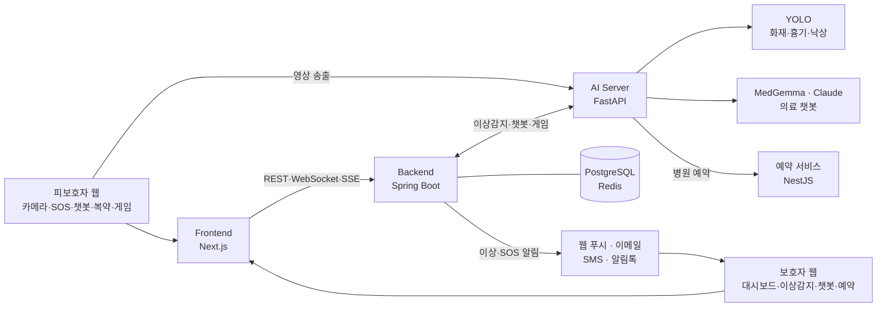

# 🌉 SilverBridge의 CareAI

**AI 기반 독거노인 통합 케어 플랫폼** — 위험 감지 → 의료 상담 → 병원 예약까지 하나의 흐름으로 연결합니다.

     

[](https://www.youtube.com/watch?v=y4lUm_REdXM) [](docs/실버브릿지_브로셔.pdf)

---

## 1. 프로젝트 소개

CareAI는 독거노인 및 취약계층을 대상으로 설계된 **의료 AI 통합 서비스**입니다.

> **2050년, 대한민국 인구의 40%는 65세 이상 시니어입니다.**
> 1인 가구 노인의 치매 유병률은 **52.6%** 로 전체 가구 형태 중 가장 높고,
> 고독사의 **90.6%** 는 집 안에서 발생합니다.

기존 서비스가 '알려주는 것'에 집중했다면, SilverBridge CareAI는 **대처하게 만드는 것**까지 포함합니다.

주요 기능은 크게 3가지입니다.

| | 핵심 기능 | 내용 |
| :---: | --- | --- |
| 🚨 | **위급 상황** | 실시간 영상 AI가 낙상·화재·흉기를 감지하면 자동 신고 및 보호자·관리자에게 즉시 알림 |
| 🏥 | **병원 예약** | AI 의료 챗봇으로 증상 상담 → 진료과 추천 → 병원 예약까지 원스톱 연결 |
| 💛 | **정서·인지 케어** | 안부 대화 기반 정서 상태 체크 + 치매 예방 인지훈련 게임으로 지속적 건강 관리 |

| | |
|:---:|:---:|
| <br/>**위급 상황 SOS** | <br/>**AI 챗봇 병원 예약** |

SilverBridge는 독거 노인 및 취약계층을 대상으로, 위험 상황을 감지하는 것에서 끝나지 않고 의료 상담과 병원 예약까지 자연스럽게 이어주는 의료 AI 통합 서비스입니다.

---

## 2. 주요 기능

### 2.1 공통 인증

- 이메일 로그인 / 카카오 소셜 로그인
- 회원가입 / 비밀번호 찾기·재설정
- JWT 기반 세션 유지 및 계정 복구
- 역할별(피보호자·보호자) 화면 분기

| | |
|:---:|:---:|
| <br/>**회원가입** | <br/>**로그인** |

### 2.2 피보호자 화면

- 카메라 실시간 영상 송출
- 위급 상황 SOS 호출
- 내 보호자 목록 조회 / 연결 요청 수락·거절·해제
- AI 의료 챗봇, 병원 검색·예약
- 복약 관리
- 치매 예방 인지훈련 게임
- 공지사항, 환경설정

| | |
|:---:|:---:|
| <br/>**메인 화면** | <br/>**카메라 송출** |
| <br/>**카메라 송출 중** | <br/>**SOS 호출** |
| <br/>**내 보호자** | <br/>**AI 의료 챗봇** |
| <br/>**병원 예약** | <br/>**예약 현황** |
| <br/>**복약 관리** | <br/>**인지훈련 게임** |

### 2.3 보호자 화면

- 보호자 홈 대시보드 (피보호자 상태 실시간 확인)
- 피보호자 목록 조회 / 등록 요청 / 요청 내역 / 연결 해제
- AI 이상감지 이력 조회 (화재·흉기·낙상) 및 이상 발생 시 영상 확인
- SOS 수신 이력
- AI 의료 챗봇 (응급 증상·병원 예약·일반 문의 모드 자동 분기)
- 병원 검색·예약
- 복약 관리
- 정서 상태 체크 (하루 5회 안부 대화 기록·감정 상태 확인)

| | |
|:---:|:---:|
| <br/>**대시보드** | <br/>**이상감지 이력** |
| <br/>**이상 발생 영상 확인** | <br/>**AI 의료 챗봇** |
| <br/>**피보호자 연결** | <br/>**병원 예약** |
| <br/>**복약 관리** | <br/>**SOS 수신 이력** |
| <br/>**정서 상태 체크** | |

### 2.4 알림

- 웹 푸시 알림
- 이메일 / SMS 알림
- 카카오 알림톡
- 알림 유형별 설정 화면

| | |
|:---:|:---:|
| <br/>**알림 환경설정** | |

### 2.5 공통

- 마이페이지
- 공지사항 조회 / 1:1 문의

| | |
|:---:|:---:|
| <br/>**공지사항** | |

---

## 3. 서비스 아키텍처 / 흐름



### 서비스 흐름

**🚨 긴급 상황**

```
카메라 → AI 분석 (낙상·화재·흉기, YOLO 모델) → 위험 판단
  → 보호자·관리자 즉시 알림 (웹 푸시·이메일·SMS·카카오 알림톡)
SOS 버튼 → 보호자 즉시 알림
```

**🏥 평소 상황**

```
AI 의료 챗봇 → 증상 채팅 입력 → Claude 라우터가 모드 자동 분기
  ├─ 응급 증상  → 응급 키워드 강제 감지 + MedGemma 의료 LLM 답변
  ├─ 병원 예약  → Claude 기반 예약 대화 → 병원 검색 → 예약 연결
  └─ 일반 문의  → 일반 안내 답변
```

**💛 정서·인지 케어**

```
치매 예방 인지훈련 게임    → 기억력·집중력 훈련 (구현)
정서 상태 체크 (안부 대화) → 하루 5회 안부 → 보호자 화면에서 감정 상태 확인 (화면 구현)
AI 말벗 (EXAONE)          → 음성 대화 → 외로움 해소·정서 케어 (개발 중)
AI 정서 분석 (HSEmotion)   → 표정·텍스트 분석 → 이상 심리 조기 감지 (개발 중)
```

---

## 4. 기술 스택

### 4.1 Frontend [](https://github.com/Dongyang-Mirae-University-software/SilverBridgeFe)

| 분류 | 기술 |
| --- | --- |
| Framework | Next.js 16 (SSR + CSR 혼합 구조) |
| Language | TypeScript |
| UI | React 19, CSS Modules |
| 서버 통신 | Axios, TanStack React Query |
| 알림 | FCM (웹 푸시) |
| 인프라 | Docker, Nginx (reverse proxy) |

### 4.2 Backend [](https://github.com/Dongyang-Mirae-University-software/SilverBridgeBe)

| 분류 | 기술 |
| --- | --- |
| Language / Framework | Java 21 / Spring Boot 4.0 |
| ORM | JPA, Hibernate |
| 통신 | WebClient, WebSocket, SSE |
| 알림 채널 | FCM, 이메일, SMS, 카카오 알림톡 |
| Database | PostgreSQL, Redis |
| 인프라 | Docker, Nginx, GitHub Actions |

### 4.3 AI Backend [](https://github.com/Dongyang-Mirae-University-software/SilverBridgeAiServer)

| 분류 | 기술 |
| --- | --- |
| Language / Framework | Python / FastAPI |
| 감지 모델 | YOLO (화재·흉기·낙상) |
| 의료 챗봇 | MedGemma (응급 답변), Claude (라우터·예약 추출) |
| 병원 예약 서비스 | NestJS |
| 인지훈련 게임 | FastAPI + SQLAlchemy |
| 인프라 | Docker, PyTorch |

> 정서 분석(HSEmotion)·AI 말벗(EXAONE)은 현재 개발 중입니다.

---

## 5. 개발 현황

**2학기 중간 발표 기준 — 정서 체크를 제외한 모든 기능 구현 완료**

| 기능 | 상태 |
| --- | :---: |
| 인증 시스템 (이메일·카카오 로그인, JWT) | ✅ 완료 |
| 보호자-피보호자 연결, 대시보드, 공지·문의, SOS | ✅ 완료 |
| AI 이상감지 (화재·흉기·낙상, WebSocket 연동) | ✅ 완료 |
| AI 의료 챗봇 (MedGemma + Claude 라우터, 병원 예약) | ✅ 완료 |
| 복약 관리 | ✅ 완료 |
| 알림 (웹 푸시·이메일·SMS·카카오 알림톡) | ✅ 완료 |
| 치매 예방 인지훈련 게임 | ✅ 완료 |
| 통합 테스트 / 운영 배포 | ✅ 완료 |
| 정서 체크 (AI 정서 분석 · AI 말벗) | 🔄 개발 중 |

### AI 모델 개선

- **흉기 감지**: 초기 인식률이 낮아 데이터셋을 재구성해 재학습하고 성능을 개선했습니다.
- **화재 감지**: 테스트에서 오감지가 많아 데이터셋을 재구성해 재학습했습니다.

### 한계 및 향후 계획

- 앉기·눕기 등 유사 행동과 구분이 어려워 오탐·미탐이 발생할 수 있으며, 데이터 보강으로 개선 중입니다.
- 정서 체크(AI 말벗 EXAONE, 표정·텍스트 분석 HSEmotion) 완성 후 보호자 화면과 연동할 예정입니다.

---

## 6. 팀 구성

| 이름 | 역할 |
| --- | --- |
| 이하늘 | **팀장 / AI / Infra** - 병원 예약 시스템, 인프라 아키텍처, AI 챗봇, 치매 예방 게임 |
| 남궁명진 | **Backend** - DB 설계, REST API, 인증/인가, 외부 서비스·AI 서버 연동, 품질/보안 관리 |
| 이윤아 | **Frontend** - Next.js/React 컴포넌트, UI/UX 설계, 반응형 레이아웃, 백엔드 API 연동 |
| 이재희 | **AI** - 정서 분석·이상감지·말벗 AI 개발 및 모델 학습 |

---

## 7. 시연 영상 / 발표 자료

### 7.1 시연 영상

- **YouTube 시연 영상**

  [](https://www.youtube.com/watch?v=y4lUm_REdXM)

- **AI 이상감지 테스트 영상** (실제 가정 환경 CCTV 촬영)

  | 흉기 감지 | 낙상 감지 |
  | --- | --- |
  | [▶ 흉기감지_테스트.mp4](videos/흉기감지_테스트.mp4) | [▶ 낙상감지_테스트.mp4](videos/낙상감지_테스트.mp4) |

### 7.2 발표 자료 / 문서

| 구분 | 파일 |
| --- | --- |
| 프로젝트 브로셔 | [](docs/실버브릿지_브로셔.pdf) |
| 1학기 중간발표 (프로젝트 제안서) | [](docs/실버브릿지_중간발표.pptx) |
| 1학기 최종발표 | [](docs/실버브릿지_최종발표.pptx) |
| 2학기 프로젝트 계획서 | [](docs/실버브릿지_2학기_프로젝트계획서.pptx) |

---

## 8. 저장소 목록

| 저장소 | 설명 |
| --- | --- |
| [SilverBridgeFe](https://github.com/Dongyang-Mirae-University-software/SilverBridgeFe) | Next.js 프론트엔드 |
| [SilverBridgeBe](https://github.com/Dongyang-Mirae-University-software/SilverBridgeBe) | Spring Boot 백엔드 |
| [SilverBridgeAi](https://github.com/Dongyang-Mirae-University-software/SilverBridgeAi) | AI 서버 (초기 버전) |
| [AiSilverBridgeSky](https://github.com/Dongyang-Mirae-University-software/AiSilverBridgeSky) | YOLO 이상감지 모델 학습·추론 서비스 |
| [ChatSilverBridge](https://github.com/Dongyang-Mirae-University-software/ChatSilverBridge) | MedGemma 의료 챗봇 서버 |
| [SilverBridgeReservation](https://github.com/Dongyang-Mirae-University-software/SilverBridgeReservation) | 병원 예약 서비스 (NestJS) |
| [SilverBridgeAiServer](https://github.com/Dongyang-Mirae-University-software/SilverBridgeAiServer) | AI 서버 (이상감지·의료 챗봇·인지훈련 게임) |
| [SilverBridgeQA](https://github.com/Dongyang-Mirae-University-software/SilverBridgeQA) | 실제 화면 E2E QA 자동화 (Playwright) |
